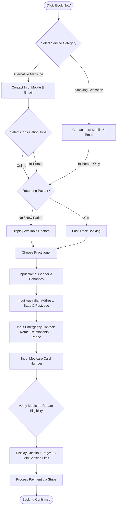

# Quality Assurance test plan:

**Intern Name:** Melati F.H
**Supervisor Name:** Michael S.
**Testing duration til deadline:** 2 weeks

# The criteria needed for success:
- Appropriate pricing for different patient types
- Valid Australian phone number
- Valid Australian address, complete with zip code
- Smooth payment experience through Stripe API

# Workflow:

